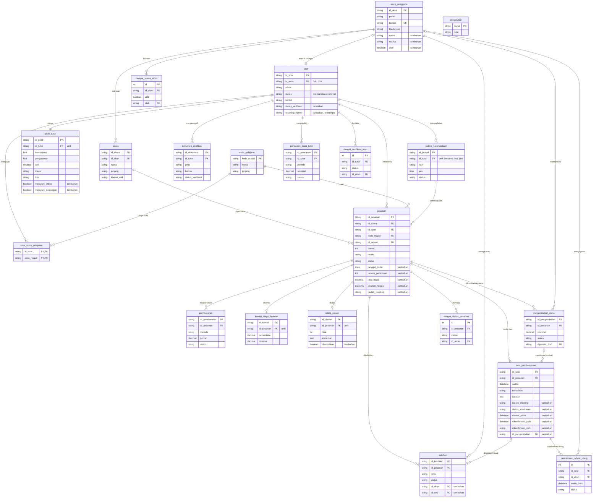
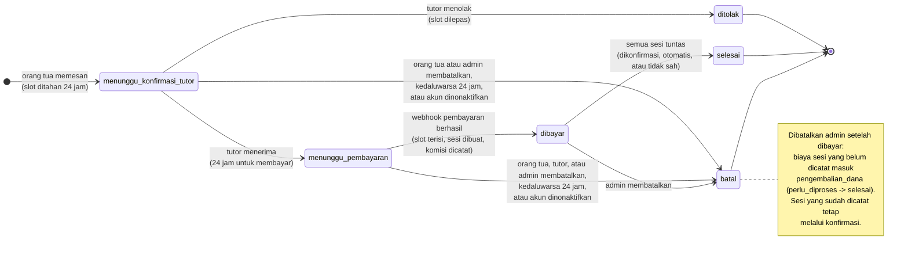
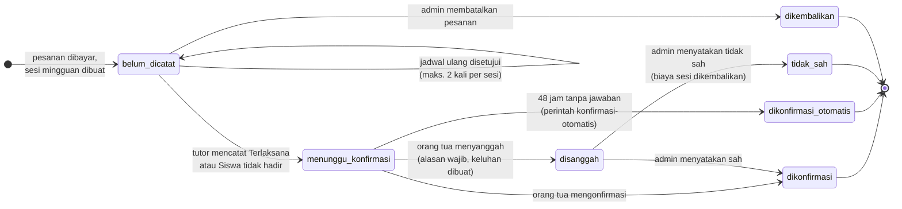
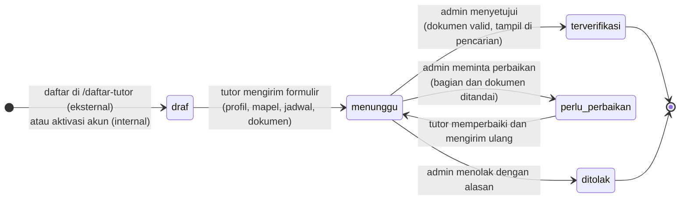
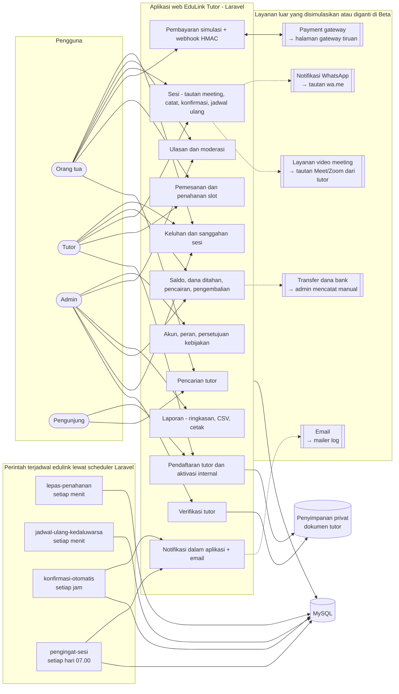

# Arsitektur EduLink Tutor v0.9 Beta

Dokumen ini menggambarkan arsitektur aplikasi seperti yang dibangun di versi Beta: struktur data, status utama, komponen, dan perbedaannya dengan rancangan arsitektur target. Diagram memakai Mermaid sehingga tampil langsung di GitHub. Rincian setiap kolom ada di [daftar-tabel.md](daftar-tabel.md).

Aplikasi berupa satu aplikasi web Laravel (monolit modular) dengan database MySQL. Logika bisnis ada di kelas layanan (`app/Services`), status di enum (`app/Enums`), dan tugas berkala dijalankan oleh scheduler Laravel.

## 1. ERD

Kunci utama berupa string berawalan (mis. `AK0001`, `ORD-2026-000045`, `SES0001`). Kolom bertanda `tambahan` tidak ada di ERD awal; alasan setiap tambahan ada di daftar-tabel.md. Agar diagram tetap terbaca, hanya kunci dan kolom penting yang ditampilkan.

### Asal tabel

| Asal | Tabel |
|---|---|
| ERD awal (15 tabel) | akun_pengguna, siswa, tutor, profil_tutor, mata_pelajaran, tutor_mata_pelajaran, dokumen_verifikasi, jadwal_ketersediaan, pesanan, sesi_pembelajaran, pembayaran, komisi_biaya_layanan, rating_ulasan, keluhan, pencairan_dana_tutor |
| Tambahan aplikasi | pengaturan, riwayat_status_pesanan, riwayat_verifikasi_tutor, riwayat_status_akun, permintaan_jadwal_ulang, pengembalian_dana, notifications, password_reset_tokens, sessions |
| Bawaan Laravel (bukan data bisnis) | cache, cache_locks, jobs, job_batches, failed_jobs, migrations |

Catatan:
- `notifications` memakai relasi polimorfik bawaan Laravel (`notifiable_id` berisi `id_akun`), tanpa foreign key, sehingga tidak digambar di ERD.
- Tabel ERD awal juga mendapat kolom tambahan (ditandai `tambahan` di diagram).

## 2. Status pesanan

Slot jadwal mengikuti status pesanan: `tersedia` → `ditahan` (pesanan dibuat) → `terisi` (dibayar) → kembali `tersedia` saat pesanan ditolak, batal, atau selesai. Pembayaran sendiri berstatus `pending` → `berhasil` atau `gagal`; orang tua boleh mencoba lagi setelah gagal selama batas waktu belum lewat.

## 3. Status konfirmasi sesi

- `belum_dicatat` dan `dikembalikan` bukan nilai kolom: `status_konfirmasi` masih kosong, dan sesi yang dikembalikan ditandai dengan `id_pengembalian`.
- Uang tutor per sesi: bagian tutor (nilai sesi − komisi) menjadi **saldo tersedia** saat `dikonfirmasi` atau `dikonfirmasi_otomatis`, dan berstatus **dana ditahan** sebelum itu. Sesi `tidak_sah` dan yang dikembalikan tidak menjadi hak tutor.

## 4. Status verifikasi tutor

Setiap langkah dicatat di `riwayat_verifikasi_tutor`. Setiap dokumen punya status sendiri (`menunggu`, `valid`, `ditolak`). Mata pelajaran tutor terverifikasi hanya bisa diubah admin, dengan alasan.

## 5. Diagram komponen

Aturan alur yang dipusatkan di satu tempat:

| Kelas layanan | Tanggung jawab |
|---|---|
| `AlurPesanan` | Semua perubahan status pesanan (dengan kunci baris), penahanan dan pelepasan slot, pembuatan sesi, linimasa |
| `PemrosesPembayaran` | Memulai pembayaran dan memproses webhook (tanda tangan, idempoten, pembayaran terlambat) |
| `KonfirmasiSesi` | Konfirmasi, sanggahan, konfirmasi otomatis 48 jam, putusan admin |
| `PembagianSesi`, `SaldoTutor`, `LaporanRingkasan` | Satu rumus uang: nilai, komisi, dan bagian tutor per sesi; saldo tersedia, dana ditahan, komisi diakui |
| `VerifikasiTutor`, `PendaftaranTutor`, `AktivasiTutor` | Alur pendaftaran dan keputusan admin |
| `Pemberitahu` | Semua notifikasi, dikirim setelah transaksi database berhasil |

## 6. Perbedaan dengan rancangan arsitektur target

Rancangan target menempatkan EduLink Tutor sebagai salah satu layanan dalam ekosistem EduLink. Versi Beta sengaja dibangun sebagai satu aplikasi mandiri supaya alur bisnis inti bisa diuji dan didemokan lebih dulu.

| Komponen target | Di versi Beta | Alasan |
|---|---|---|
| Integrasi EduManage (data siswa, pengajar internal, akademik) | Tidak diimplementasikan. Pengajar internal di-seed sebagai data awal dan mengaktifkan akun sendiri di `/aktivasi-tutor`. | EduManage belum menyediakan antarmuka yang bisa dipakai; dengan data awal, alur aktivasi tetap bisa ditunjukkan. |
| SSO antar-aplikasi EduLink | Tidak diimplementasikan. Login email dan kata sandi per aplikasi, dengan peran ortu, tutor, admin. | Butuh penyedia identitas bersama yang belum ada; login lokal cukup untuk menguji hak akses per peran. |
| API Gateway | Tidak diimplementasikan. Aplikasi melayani halaman web langsung; satu-satunya endpoint untuk sistem luar adalah webhook pembayaran. | Belum ada layanan lain yang memanggil EduLink Tutor, sehingga gateway belum memberi nilai. |
| Payment gateway | Disimulasikan: halaman gateway tiruan mengirim hasil ke webhook bertanda tangan HMAC, hanya saat mode demo aktif. | Integrasi sungguhan butuh akun merchant dan uang nyata. Kontrak webhook-nya sudah sama, jadi penggantiannya terbatas pada pengirim notifikasi. |
| Transfer dana (pencairan tutor, pengembalian orang tua) | Admin mencatat bahwa transfer sudah dilakukan. | Tidak ada integrasi bank; pencatatan tetap menjaga saldo dan jejak audit. |
| Layanan video meeting | Diganti tautan Google Meet/Zoom yang dibagikan tutor per pesanan atau per sesi. | Membangun atau menyewa layanan video di luar cakupan Beta; tutor sudah terbiasa dengan layanan yang ada. |
| Notifikasi WhatsApp | Diganti tombol tautan `wa.me` untuk pesanan yang sudah dibayar; notifikasi lain lewat aplikasi dan email. | WhatsApp Business API berbayar dan butuh verifikasi bisnis. |
